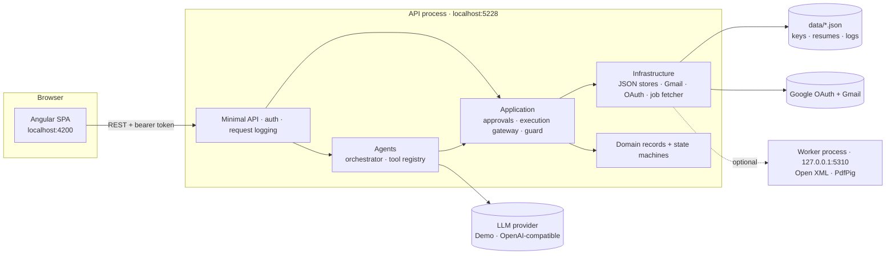
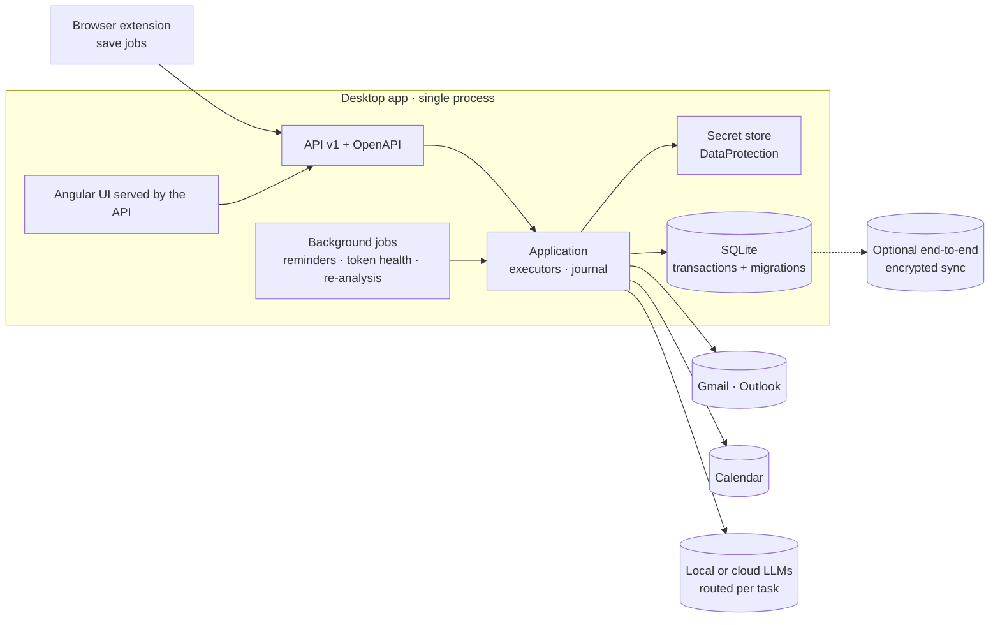

# Engineering review — Job Hunter

**Three lenses: senior software developer → tech lead → architect**

> Reviewed: branch `Arvind/logImplementation_BugFix_Improvements` @ `5b7419e` · 8 October 2026
> Scope: all 9 production projects, 6 test projects, the Angular app, scripts and docs. Every number below was measured (see the appendix), not estimated.

## At a glance

| Area | Rating | Verdict |
| --- | :---: | --- |
| Code quality | ★★★★☆ | Modern, readable C# and TypeScript; a few oversized classes and endpoint files |
| Correctness & safety | ★★★★☆ | The approval-first kernel is excellent; password reset is the weak spot |
| Tests | ★★★☆☆ | 193 tests and 75 % line coverage, but the riskiest adapters are almost untested |
| Engineering process | ★☆☆☆☆ | No CI, analyzers, formatting, dependency automation or release process |
| Architecture | ★★★★☆ | Clean layering and good ports; consistency and single-instance assumptions need explicit design |
| Security architecture | ★★☆☆☆ | DNS rebinding + username-only reset = remote account-takeover path; plaintext secrets |
| Operability & distribution | ★★☆☆☆ | Logging is now solid; no packaging, health checks or background jobs |

### Evidence snapshot

| Measure | Value |
| --- | --- |
| Production code | ≈5,100 lines of C# in 9 projects · ≈2,700 lines of TypeScript (Angular, incl. specs) |
| HTTP endpoints | 65, of which 9 anonymous |
| Tests | 169 .NET + 24 Vitest, all green (≈20 s for .NET) |
| Line coverage (hand-written code, merged across test projects) | **75.1 %** — Logging 90.0 · Domain 85.7 · Agents 79.2 · Application 78.0 · Api 77.8 · Infrastructure 67.2 · ResumeAutomation **0.9** |
| Least-tested code | `OpenXmlResumeDocumentService` 0.9 % · `GmailClient` 3.6 % · `GoogleOAuthService` 4.4 % · `ApplicationService` 31.9 % · `JobService` 37.9 % |
| Build hygiene | 0 compiler warnings; Angular `strict` + `strictTemplates` enabled |
| Dependencies | No vulnerable NuGet packages; **1 high npm advisory** (`@angular/router` < 22.2.0, server-side-rendering DoS — not exploitable here, fix available within the declared range) |
| Tooling | No CI · no `.editorconfig` or analyzer settings · no ESLint/Prettier · no central package management · no `global.json` |
| Runtime | No background services; sessions, locks and caches live in process memory |

---

## 1. Senior software developer — code level

### What is working well

- **Domain model** — immutable records with intention-revealing methods (`ApprovalRequest.Decide/Consume/Invalidate`, `JobApplication.TransitionTo` with an explicit transition table). Invalid states are hard to represent.
- **Small, sharp safety pieces** — `ExternalActionGuard` is about 20 lines and does one job; payload hashing makes "approve exactly this content" verifiable.
- **Modern C#** — primary constructors, records, pattern matching, nullable reference types, consistent `CancellationToken` flow, source-generated regexes.
- **Angular** — standalone components, signals, the new control flow (`@if`/`@for`), functional interceptor and guard, strict templates.

### Comments and improvements

| # | Severity | Observation (evidence) | Recommendation |
| --- | --- | --- | --- |
| D1 | Medium | **Business logic lives in endpoint lambdas.** `ReadModelEndpoints.cs` (14.5 KB, the largest API file) validates LLM settings, writes uploaded files to disk, runs imports and drives OAuth — and its name hides that it contains commands. | Split into `SettingsEndpoints`, `DataEndpoints`, `IntegrationEndpoints`; move the rules into Application services (`SettingsService.UpdateAsync`, `MasterResumeService.UploadAsync(stream, fileName)`) so they can be unit-tested without HTTP. |
| D2 | Medium | **Error handling is copy-pasted.** 17 `try/catch` blocks in endpoints map exception types to status codes and produce three response shapes (`{ error }`, `ValidationProblem`, `Problem`). | One `IExceptionHandler` that maps domain exceptions (not found, conflict, approval violation, agent failure, validation) to ProblemDetails with the correlation id; endpoints only return `TypedResults`. |
| D3 | Medium | **Contract validation is decorative.** `[Required]`/`[MaxLength]` on the `Contracts` records are not enforced by minimal APIs; the same checks are hand-written in endpoints. | Turn on .NET 10 minimal-API validation (`builder.Services.AddValidation()`) or FluentValidation and delete the manual checks. |
| D4 | Medium | **Classes with too many collaborators.** `AgentOrchestrator` takes 12 constructor dependencies, `ExecuteApprovedActionCommand` 11 plus a `switch` over action types. | Strategy per action: `IApprovalExecutor { ActionType; ExecuteAsync(...) }` (resume, Gmail draft, Gmail send). The gateway keeps locking, receipts and audit; a new action such as `SEND_FOLLOW_UP` becomes a new class, not an edit. Split the orchestrator per workflow. |
| D5 | Medium | **Hidden clock.** 57 direct `DateTimeOffset.UtcNow` calls outside the logger make expiry, follow-up and session logic hard to test deterministically. | Inject `TimeProvider` (built into .NET 8+); domain methods take `now` (several already do). |
| D6 | Low | **Stringly-typed values.** 25 audit calls with string action names, 7 literal `"SKILL"`/`"COVER_LETTER"`/`"RECRUITER"` uses, provider names `"Demo"`/`"OpenAI"`, tools fetched by name. | Enums or constants (`AuditActions`, `FactTypes`, `EmailKinds`, `LlmProviders`) and tool lookup by type, so typos become compile errors. |
| D7 | Low | **Application does file-system work.** `ExecuteApprovedActionCommand` uses `File.Exists`/`Path.*` (4 call sites) to compute output paths. | Move the path policy behind `IResumeDocumentService` (or an `IFileSystem` port); the Application layer stays pure, and its tests no longer need real temp files. |
| D8 | Low | **One inconsistent aggregate.** `CandidateProfile` is the only mutable class; its `Version` is always empty (optimistic concurrency is promised but not implemented) and its timestamps are not persisted. | Make it a record like the others; persist timestamps; implement or drop `Version`. |
| D9 | Medium | **LLM output handling is fragile.** `LlmJson.Parse` slices from the first `{` to the last `}`; prompts are string concatenations in `Tools.cs`; there is no schema validation or repair retry. | Prompt templates as versioned resources; JSON-schema structured outputs where the provider supports them; validate required fields and ranges and retry once with the validation error; tests with recorded model responses. |
| D10 | Low | **Regex HTML parsing.** `HttpJobPostingFetcher` (15.5 KB) parses HTML with regular expressions and always decodes as UTF-8. | Use AngleSharp for DOM, meta and JSON-LD extraction; honour the `charset` of `Content-Type`. |
| D11 | Low | **Dead references.** `Agents` and `ResumeAutomation` reference `Contracts` without using it; `GoogleOAuthOptions` is unused and duplicates a constant. | Remove them; an architecture test (A4) keeps references honest. |
| D12 | Medium | **Large inline components.** 17 of 18 Angular components inline their template and styles; `settings.component.ts` is 24 KB, `job-detail` 13 KB. | Separate `.html`/`.scss` files; split Settings into child components (execution mode, LLM, Google, master resume, backup). |
| D13 | Medium | **Front-end duplication and drift.** The same `run()` busy/error helper exists in 7 components; `models.ts` hand-copies the C# contracts — the root cause of the missing `?send=` bug fixed earlier. | A shared `AsyncAction`/signal-store helper; generate the TypeScript models and client from OpenAPI (A9). |
| D14 | Medium | **No component tests** — 0 component specs; only services are tested. | Start with Approvals and Settings, the screens that trigger side effects. |
| D15 | Low | `crypto.randomUUID()` (idempotency keys) exists only in secure contexts, so opening the UI through a LAN IP over HTTP breaks *Execute*. | Add a small fallback generator. |
| D16 | Medium | **The author's profile is the seed data.** On first start `SeedAsync` (`Program.cs`) creates the author's name, title and employer plus 14 skills, and marks the skills **verified**. Any other user starts with someone else's verified facts, which breaks the product's core rule that only facts the user confirmed are used. | Start with an empty profile and onboarding (business analysis, E1); never auto-verify seeded facts; keep personal defaults in an ignored local file or an explicitly labelled sample workspace (L10). |

---

## 2. Tech lead — team, quality and delivery

### What is working well

- A documentation culture: README, `docs/`, an ADR, a launcher script, a smoke-test script, and a safety model that is written down **and** enforced by tests.
- Fast feedback: the .NET suite runs in about 20 seconds, Vitest in about 40.
- Tests read like specifications (`ConcurrentExecutions_WithDifferentKeys_SendTheEmailOnlyOnce`).

### Comments and improvements

| # | When | Observation | Recommendation |
| --- | --- | --- | --- |
| L1 | **Now** | **No CI.** Nothing protects `main`; a stale Worker binary went unnoticed during this review because `dotnet test` does not build the Worker. | GitHub Actions: `dotnet build -warnaserror`, `dotnet test` with coverage, `npm ci && npm test && ng build`; required checks and branch protection on `main`. |
| L2 | **Now** | **Coverage is inverted relative to risk.** Gmail (3.6 %), Google OAuth (4.4 %) and resume generation (0.9 %) — the code that emails recruiters and writes CVs — are the least tested. | Adapter contract tests with stub HTTP handlers (token refresh, `invalid_grant`, 401/403/429/5xx) and golden-file tests for Open XML (fixture `.docx` in, assert text and formatting out). Gate at ≥80 % for Domain, Application and every side-effect adapter. |
| L3 | **Now** | **Secrets hygiene.** The Settings page wrote a real Google client secret into the tracked `appsettings.json`. | `dotnet user-secrets` for development; the app never writes secrets into tracked files (A8); a gitleaks pre-commit hook and GitHub push protection. |
| L4 | Next | **No static analysis or formatting.** | `.editorconfig`; `Directory.Build.props` with `Nullable`, `AnalysisLevel=latest-recommended` and `TreatWarningsAsErrors` (in CI); `dotnet format --verify-no-changes`; angular-eslint, Prettier and lint-staged. |
| L5 | Next | **Manual dependency management.** Versions are spread over 11 project files, test packages are repeated ×6, `Microsoft.Extensions.*` 10.0.0 sits next to DataProtection 10.0.10, and two SDKs are installed (6.0.309, 10.0.401) without `global.json`. | Central Package Management (`Directory.Packages.props`), `global.json`, Dependabot or Renovate for NuGet, npm and Actions; run `npm update` now for the router advisory. |
| L6 | Next | **Git workflow.** Three commits in history, the last one touching 75 files. | Small pull requests per concern, Conventional Commits, a PR template with a *safety-model checklist* ("does this add a side-effect path outside `ExecuteApprovedActionCommand`?"), squash merges, SemVer tags and a CHANGELOG. |
| L7 | Next | **Documentation drift.** `architecture.md` still describes "Phase 1" (Word Interop, SQL Server, aggregates that do not exist). | Refresh it with C4 diagrams, keep one ADR per significant decision, and update docs in the same PR as the code. |
| L8 | Next | **No Definition of Done.** | Unit and integration tests · log statements at decision points · audit for state changes · docs/ADR · no new warnings · security checklist · loading, empty and error UI states. |
| L9 | Next | **Known issues live only in a document.** | Turn the open items of `code-review-findings.md` into labelled GitHub issues (security, bug, tech-debt) with priorities — password reset first. |
| L10 | Later | **Developer experience.** | `global.json`, a dev container, `dotnet watch`, launcher verbs `test`/`lint`/`build`, richer `.http` files, demo seed data. |
| L11 | Later | **Release engineering.** | A packaged release (`dotnet publish` self-contained + `ng build`), versioned artifacts, release notes. |

---

## 3. Architect — system design

### Current architecture

### Strengths

- **The approval-first safety kernel is the crown jewel**: payload-hash-bound, single-use, mode-bound approvals; one execution gateway; a tool registry that withholds high-risk tools from agents; receipts and audit for every outcome. This is rare in the market and deserves architecture tests that protect it.
- **Ports and adapters** for LLM, Gmail, resume documents and job fetching — Demo, OpenAI-compatible and local models, and the optional worker, are already swappable.
- **Process isolation** for untrusted documents (a loopback worker with a shared secret).
- **Crash-safe JSON storage** (versioned envelopes, atomic replace, backup, quarantine) and now end-to-end **correlation ids**.

### Comments and improvements

| # | Severity | Observation | Recommendation |
| --- | --- | --- | --- |
| A1 | **High** | **Remote account-takeover path.** The API listens on localhost with `AllowedHosts: "*"`, and `/api/auth/reset-password` is anonymous and needs only the username. A malicious web page can use **DNS rebinding** (its domain re-resolving to 127.0.0.1) to call the reset endpoint, sign in, read all data and — in LIVE mode — approve and execute Gmail sends. Browser private-network protections only partly help. | Now: restrict `AllowedHosts` to `localhost;127.0.0.1;[::1]` (host-header validation is the standard defence for local servers); fix the reset flow (current password or a recovery code); require a custom header on mutating requests to force CORS preflights. |
| A2 | High | **No transaction boundary.** One execution writes five JSON files (receipts, approvals, drafts or resumes, applications, audit). The process lock serialises executions but does not make the writes atomic — a crash in between can leave "email sent, approval still APPROVED". | Short term: an **execution journal** (persist `EXECUTING(approval, key)` before the side effect and reconcile at start-up). Medium term: **SQLite** (EF Core or Dapper) with transactions and migrations — still one local file and local-first, queryable, and no more whole-file rewrites (the unbounded `audit.json`). |
| A3 | Medium | **Idempotency stops at the process boundary.** Receipts make retries idempotent locally, but after a crash the app cannot tell whether Gmail accepted a message. | **Two-phase send** with the scope already granted: create a Gmail draft (store its id in the journal), then `drafts.send`. On recovery, a draft that no longer exists was sent. Stamp messages with an `X-JobHunter-Approval` header for traceability. |
| A4 | Medium | **Layer leaks.** Endpoints use Infrastructure types (`DataPortabilityService`, `ICacheInvalidatable`) and do file I/O (5 places); Application uses `System.IO` (4 places); the orchestrator persists domain changes itself. | Route everything through Application ports and enforce it with architecture tests (NetArchTest or ArchUnitNET): Domain → nothing, Application → Domain only, Api → Application and Contracts. |
| A5 | Medium | **Single-instance assumptions are implicit.** In-memory sessions (a restart signs you out), a static execution lock, singleton caches and the constant `LocalUser.Id` inside the Domain. Correct for a desktop app, but undocumented. | Record the constraint in an ADR and put each assumption behind a port (`ISessionStore`, `IExecutionLock`, `ICurrentUser`), so a multi-user edition becomes an adapter change, not a rewrite. |
| A6 | Medium | **No background processing.** Follow-ups, approval expiry, Gmail token health and retention only happen when someone calls an endpoint. | A small job layer (`BackgroundService` or Quartz.NET): reminder notifications, expiry sweep, token-health check, audit compaction, nightly re-analysis of saved jobs. |
| A7 | Medium | **Gmail integration constraints.** The app requests `gmail.compose`, which Google classifies as a **restricted** scope — distributing the app to other users needs Google verification plus a security assessment. While the OAuth client is in **Testing** status, Google issues refresh tokens that **expire after 7 days**, so Gmail silently disconnects every week. | Use `gmail.send` (a *sensitive* scope with lighter review) if drafts are not essential; detect `invalid_grant` and show "Reconnect Gmail"; document the Testing-mode limit; plan Outlook (Microsoft Graph) as a second mail provider. |
| A8 | Medium | **Inconsistent secrets at rest.** The Google refresh token is DataProtection-encrypted, but the LLM API key (`settings.json`) and the Google client secret (`appsettings.json`) are plain text. | One `ISecretStore` backed by DataProtection (DPAPI today; Keychain/libsecret later); configuration files hold only references. |
| A9 | Medium | **Implicit API contract.** No OpenAPI, no versioning, mixed error shapes, hand-written TypeScript models. | `AddOpenApi()` plus Scalar UI in Development, a `/api/v1` route group, ProblemDetails everywhere, and a generated TypeScript client in the Angular build. |
| A10 | Medium | **The LLM layer lacks production concerns.** No retry or backoff on 429/5xx, no per-task model routing, no prompt versioning or evaluation, no caching, no cost tracking. | `Microsoft.Extensions.Http.Resilience` (retry, timeout, circuit breaker); cheap models for extraction and stronger ones for writing; versioned prompts with a golden-set evaluation in CI; caching by (prompt version, input hash); tokens and cost on `AgentRun`; send the model only the data it needs; first-class local models (Ollama through the OpenAI-compatible endpoint). |
| A11 | High (product) | **Developer-only distribution.** Running the app needs the .NET SDK, Node and two dev servers. | Serve the Angular build from the API (`UseStaticFiles` + `MapFallbackToFile`) → one process, one port, same origin (CORS disappears); self-contained single-file publish; a desktop shell with tray icon and auto-update (WebView2-based, MSIX/winget). |
| A12 | Low | **Supportability.** Markdown logs suit a single user; there is no health model or diagnostics bundle. | `/health` with dependency checks (data folder writable, LLM reachable, Gmail token valid, worker up); optional OpenTelemetry export; an in-app *Diagnostics* page with recent errors and a "download diagnostic bundle" (logs plus settings without secrets). |

### Target architecture (12–18 months)

**Evolution path:** desktop single-user (now) → desktop with optional encrypted sync and a mobile companion → team/coach edition (OIDC sign-in, PostgreSQL, per-tenant keys, queue-based workers) — reusing the same Application layer if A4 and A5 are done first.

### Decisions that deserve an ADR

ADR-003 Markdown logging · ADR-004 Approval engine and execution gateway · ADR-005 Persistence evolution (JSON → SQLite) · ADR-006 LLM provider and prompt strategy · ADR-007 Distribution model · ADR-008 Single-user constraints and the multi-user path.

---

## 4. Consolidated action plan

| When | Actions |
| --- | --- |
| **This week** | A1 host filtering + password-reset fix · A7 `invalid_grant` handling · L1 CI · L3 secret scanning · `npm update` for the router advisory |
| **Next 1–2 months** | D16 neutral first-run profile · D1–D3 thin endpoints, exception handler, validation · D4 executor strategy · D5 `TimeProvider` · L2 adapter tests · A2 SQLite + execution journal · A6 background jobs · A8 secret store · A9 OpenAPI + generated client · A11 single-process app + single-file publish · L4/L5 analyzers, formatting, central packages |
| **Next quarter** | A3 two-phase send · A10 LLM resilience, routing, evaluation, cost · A4/A5 architecture tests and ports · A12 health + diagnostics · desktop packaging and auto-update · D12–D14 front-end restructuring and component tests |

---

## Appendix — how the evidence was gathered

- **Size:** non-blank lines of `*.cs`/`*.ts` per project (bin, obj, node_modules and data excluded).
- **Coverage:** `dotnet test --collect:"XPlat Code Coverage"`; the six Cobertura reports were merged per source line (union of hits), with generated `obj/` code excluded.
- **Vulnerabilities:** `dotnet list package --vulnerable --include-transitive --source https://api.nuget.org/v3/index.json`; `npm audit --omit=dev`.
- **Google facts:** Google's Gmail API scope classification and the OAuth 2.0 "Refresh token expiration" documentation, checked on 8 October 2026.
